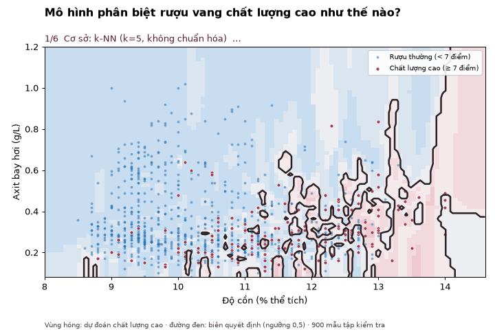

# Nhận dạng rượu vang chất lượng cao – Wine Quality (UCI)

Bài tập nhóm cuối kỳ, học phần Nhận dạng mẫu – Học viện Công nghệ Bưu chính Viễn thông. Giảng viên hướng dẫn: Nguyễn Xuân Đức.

| Thành viên | MSSV | Nhiệm vụ | Đóng góp |
|---|---|---|---|
| Nguyễn Quốc Cường | B26CHKH013 | Phân tích bài toán, làm slide | 50% |
| Trần Như Đức | B26CHKH027 | Code thuật toán, làm báo cáo | 50% |

- **Dữ liệu:** Wine Quality, Cortez et al. (2009), UCI ML Repository – https://archive.ics.uci.edu/dataset/186/wine+quality (doi 10.24432/C56S3T).
  Thư mục `data/` chứa sẵn `winequality-red.csv`, `winequality-white.csv`, `winequality.names` (bản tải từ UCI, đã đối chiếu SHA-1).
  Dùng thư mục dữ liệu khác: `python run_experiments.py --data-dir ~/Downloads/wine+quality`. Thiếu tệp thì script tự tải từ UCI.
- **Bài toán:** phân lớp nhị phân, rượu chất lượng cao (điểm ≥ 7) và rượu thường, từ 11 chỉ tiêu hóa lý cộng loại rượu.
- **Cơ sở:** k-NN trên dữ liệu thô, Naive Bayes. **Cải tiến:** chuẩn hóa, cân bằng lớp, SVM RBF, logistic, LDA/QDA, RF, Gradient Boosting, chọn ngưỡng.

## Minh họa động: mô hình phân biệt rượu tốt như thế nào



Biên quyết định của 6 mô hình (k-NN thô, k-NN chuẩn hóa, Naive Bayes, logistic, SVM RBF, Random Forest) trên 2 đặc trưng mạnh nhất, vẽ cùng 900 mẫu tập kiểm tra.
Bản tương tác (kéo ngưỡng, xem ma trận nhầm lẫn): mở `viz/PhanLop_Dong.html` trong trình duyệt. Chỉ dùng 2 đặc trưng để vẽ được trên mặt phẳng, nên số liệu thấp hơn kết quả 12 đặc trưng trong báo cáo.

## Chạy

```bash
python -m venv .venv && source .venv/bin/activate
pip install -r requirements.txt
python run_experiments.py   # 5–10 phút → results/, figures/, model_best.joblib
python robust_dedup.py      # so sánh có / không có bản ghi trùng
python gen_report.py        # → BaoCao_NhanDangMau.docx
python gen_slides.py        # → Slide_NhanDangMau.pptx
streamlit run app.py        # demo tại http://localhost:8501
```

## Cấu trúc

| Tệp | Nội dung |
|---|---|
| `run_experiments.py` | Tải dữ liệu, loại trùng, kiểm định chéo lồng nhau, kiểm định thống kê, phân tích lỗi, vẽ hình |
| `robust_dedup.py` | Ảnh hưởng của 1.177 bản ghi trùng |
| `app.py` | Demo Streamlit: chỉnh chỉ tiêu, ngưỡng, xem PCA, dự đoán từ CSV |
| `gen_report.py`, `gen_slides.py`, `gen_phancong.py` | Sinh báo cáo, slide, bảng phân công từ kết quả |
| `members.py` | Thành viên, nhiệm vụ, tỉ lệ đóng góp (dùng chung cho 3 script trên) |
| `gen_viz.py` | Minh họa động biên quyết định trên 2 đặc trưng (độ cồn, axit bay hơi): sinh `viz/viz_data.js` cho trang `viz/PhanLop_Dong.html` và ảnh `figures/phan_lop_dong.gif` |
| `results/` | Bảng số liệu (CSV/JSON) |
| `figures/` | Hình dùng trong báo cáo và slide |
| `BaoCao_NhanDangMau.docx`, `Slide_NhanDangMau.pptx`, `PhanCong_TuDanhGia.docx` (mỗi file kèm bản `.pdf`) | Sản phẩm nộp |

> `model_best.joblib` được lưu bằng scikit-learn 1.6; nếu phiên bản khác báo lỗi khi mở demo, chạy lại `python run_experiments.py` để tạo lại.
